# Gestión de productos financieros

Aplicación frontend en Angular para listar, buscar, crear, editar y eliminar productos financieros. El proyecto incluye un backend local y pruebas unitarias con Jest.

## Requisitos

- Windows 10/11.
- Node.js **18.19 o superior** y npm. Comprueba las versiones en PowerShell:

  ```powershell
  node --version
  npm --version
  ```

- El backend debe poder usar el puerto `3002`; el frontend utiliza `4200`.

## Estructura del proyecto

- `repo-interview-main`: API backend en Express, puerto `3002`.
- `banco-productos-frontend`: aplicación Angular y pruebas Jest.

## Instalación inicial

Si es la primera vez que ejecutas el proyecto, instala las dependencias de cada aplicación. Abre PowerShell y ejecuta:

```powershell
Set-Location 'D:\usuario\Documents\prueba_tecnica_devsu\repo-interview-main'
npm install
```

En una terminal aparte:

```powershell
Set-Location 'D:\usuario\Documents\prueba_tecnica_devsu\banco-productos-frontend'
npm install
```

La instalación solo es necesaria la primera vez o después de cambios en los archivos de dependencias.

## Iniciar la aplicación

El backend y el frontend deben permanecer ejecutándose al mismo tiempo, cada uno en su propia ventana de PowerShell.

### 1. Iniciar el backend

En la primera terminal:

```powershell
Set-Location 'D:\usuario\Documents\prueba_tecnica_devsu\repo-interview-main'
npm run start:dev
```

Espera el mensaje que indica que el servidor está disponible en `http://localhost:3002`. No cierres esta terminal mientras uses la aplicación.

### 2. Iniciar el frontend

En una segunda terminal:

```powershell
Set-Location 'D:\usuario\Documents\prueba_tecnica_devsu\banco-productos-frontend'
npm start
```

Cuando Angular indique que terminó de compilar, abre:

```text
http://localhost:4200
```

El servidor de desarrollo reenvía las solicitudes de `/bp/products` al backend mediante `banco-productos-frontend/proxy.conf.json`. Por eso, para trabajar localmente, inicia el backend antes de usar las operaciones de productos.

## Ejecutar las pruebas unitarias

Las pruebas unitarias del frontend están hechas con **Jest**; no requieren abrir un navegador ni tener el backend ejecutándose.

En una terminal:

```powershell
Set-Location 'D:\usuario\Documents\prueba_tecnica_devsu\banco-productos-frontend'
npm test
```

Jest ejecuta las pruebas y genera el reporte de cobertura en:

```text
banco-productos-frontend\coverage\banco-productos-frontend
```

La configuración establece un mínimo global del **70%** para sentencias, ramas, funciones y líneas. Si alguna métrica no alcanza ese porcentaje, el comando termina con error.

## Compilar para producción

Para comprobar la compilación Angular:

```powershell
Set-Location 'D:\usuario\Documents\prueba_tecnica_devsu\banco-productos-frontend'
npm run build
```

Los archivos compilados se generan en `banco-productos-frontend\dist\banco-productos-frontend`.

## Evidencia visual y pruebas

Las pruebas Jest verifican el comportamiento del código automáticamente. Las capturas siguientes documentan visualmente las principales funciones; son evidencia complementaria y **no sustituyen las pruebas unitarias**. Los archivos se encuentran en `docs/capturas`.

### Listado, búsqueda y paginación

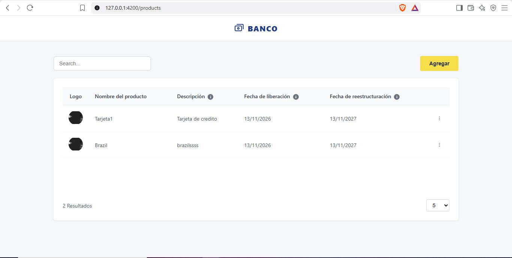

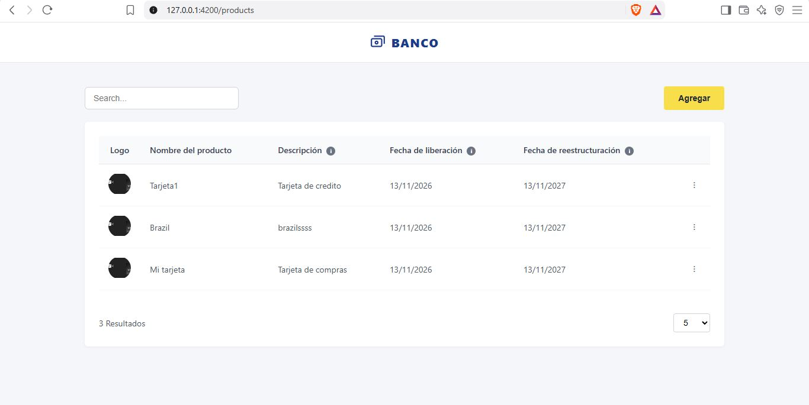

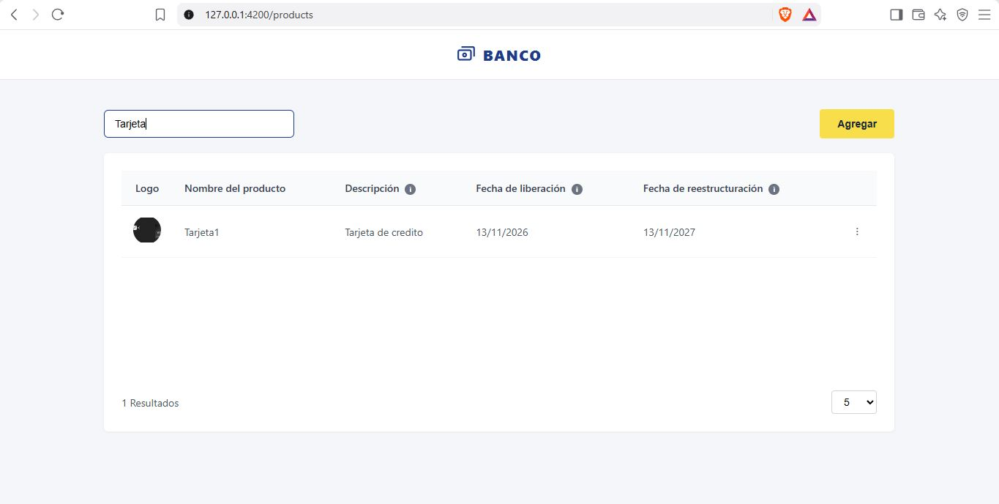

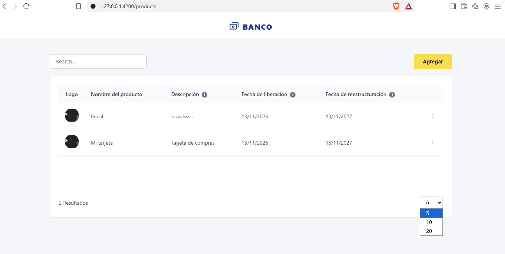

### Creación y validaciones

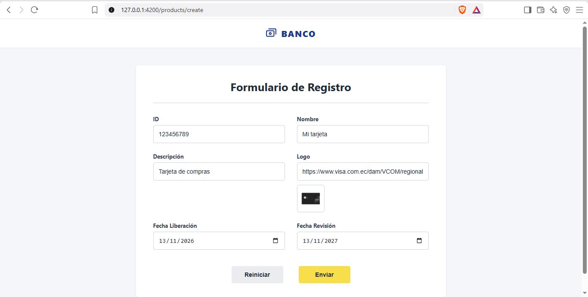

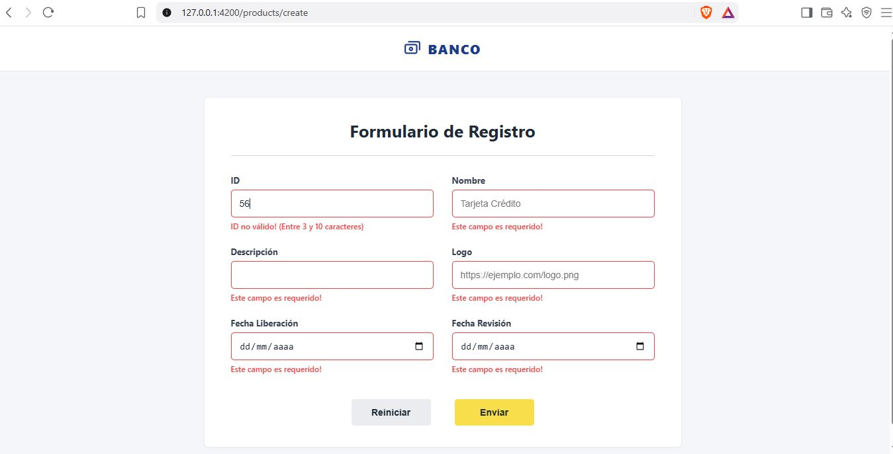

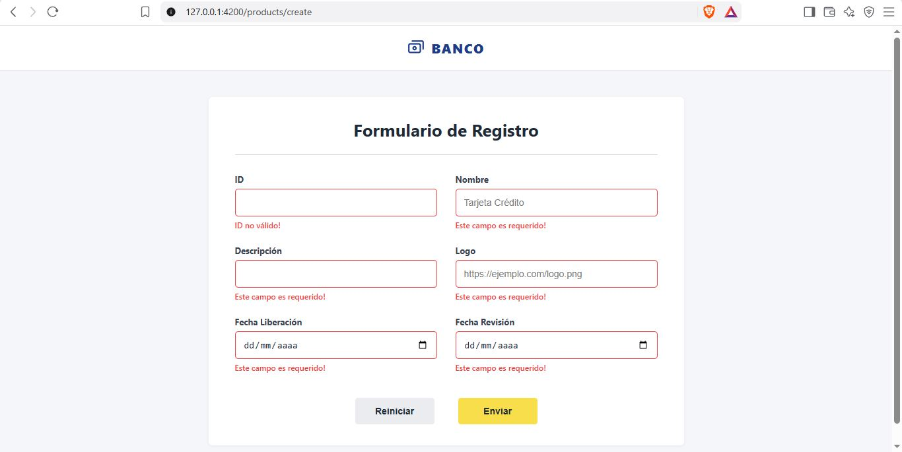

### Edición

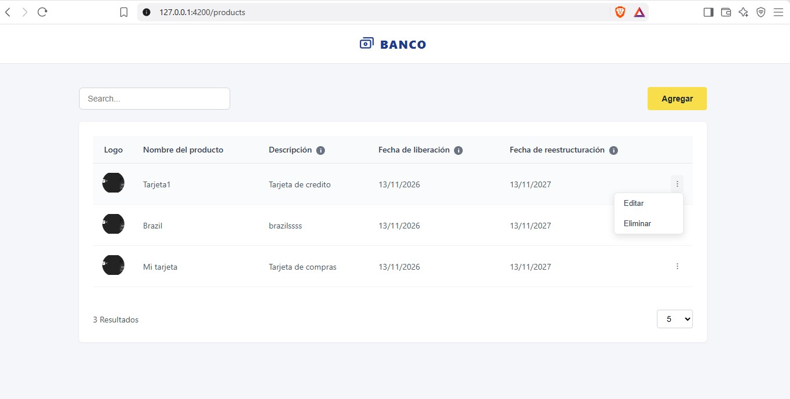

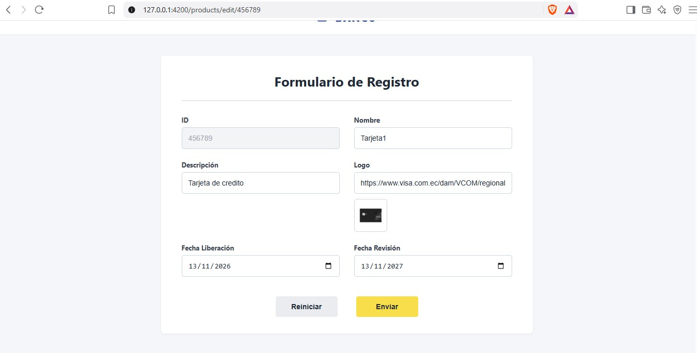

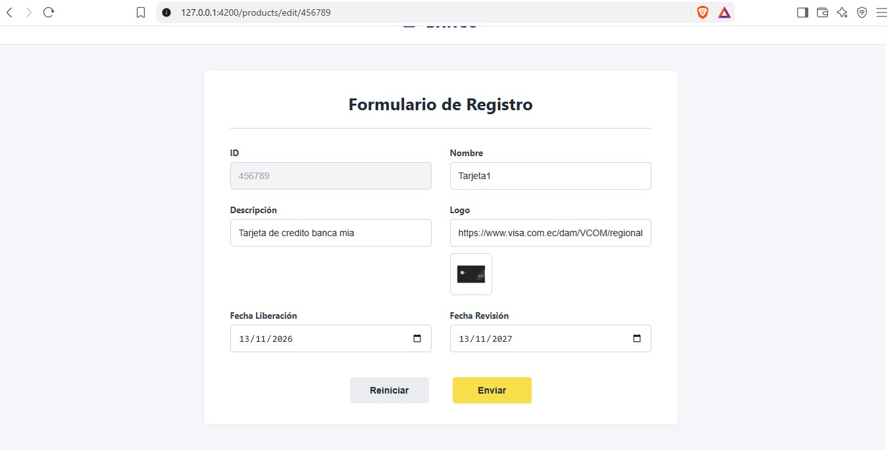

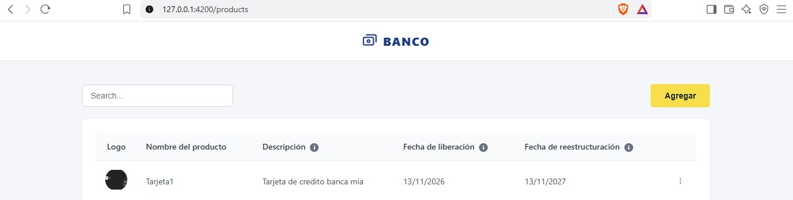

### Eliminación

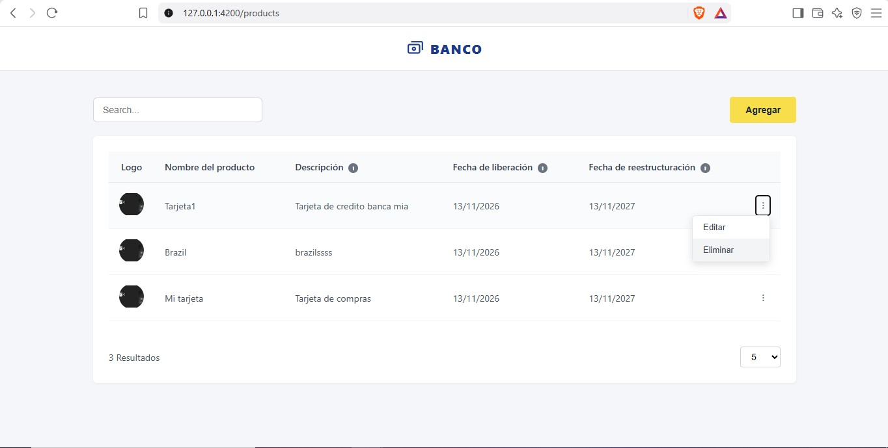

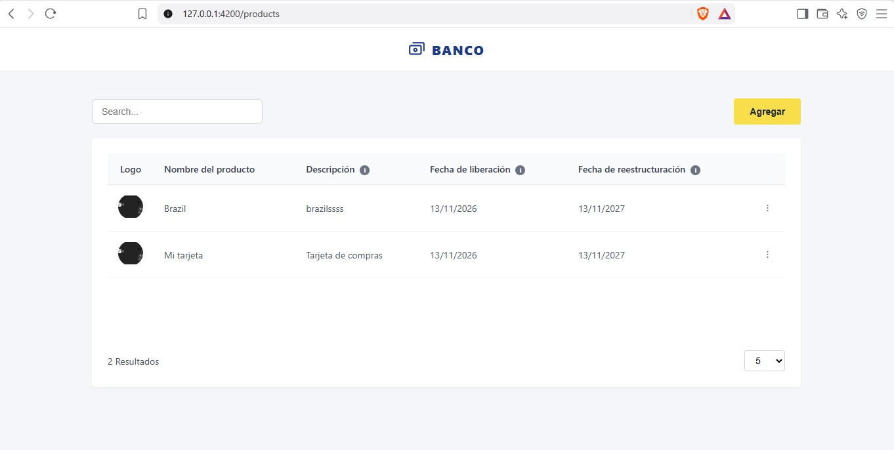

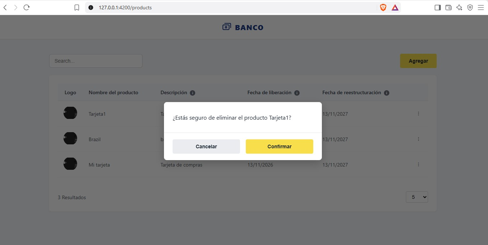

## Detener los servidores

En cada terminal donde se esté ejecutando un servidor, presiona `Ctrl+C`.

## Solución de problemas

- **El frontend indica que no se puede conectar al backend:** confirma que la terminal del backend sigue activa y que escucha en `http://localhost:3002`.
- **El puerto `4200` o `3002` ya está ocupado:** detén la instancia anterior del servidor o libera el puerto antes de volver a iniciarlo.
- **Error de versión de Node.js:** instala Node.js `18.19` o superior, abre una terminal nueva y verifica con `node --version`.
- **Faltan dependencias:** ejecuta `npm install` desde la carpeta del proyecto que presenta el error.
- **Las pruebas no pasan la cobertura mínima:** consulta el resumen impreso por Jest y el reporte HTML dentro de la carpeta `coverage`.
